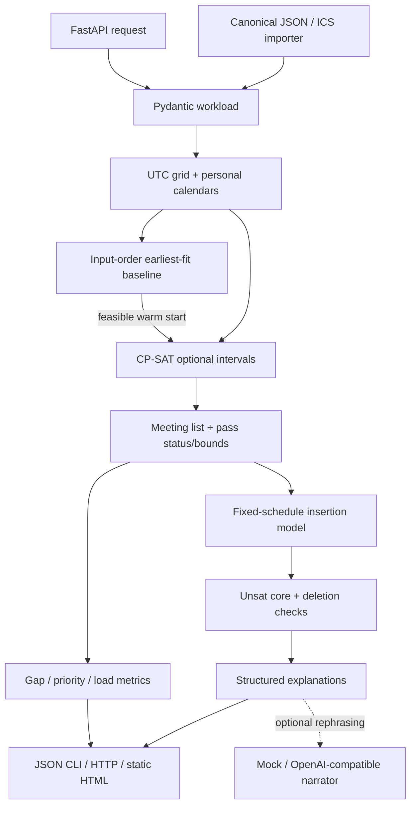

# Design: explainable optimal scheduling

## Problem and constraints
Schedule bounded meeting requests across personal calendars, then explain both
assignments and exclusions without an LLM deciding feasibility. All bundled data
is synthetic. The implementation is original Python 3.12 with OR-Tools CP-SAT,
Pydantic, FastAPI, icalendar, httpx and the standard library.

Scope: at most 500 people, 1200 requests and a seven-day horizon. No database,
remote calendar writes, account credentials, production service or employer data.
These are input bounds, not a guarantee that every dense instance solves quickly.

## Public contract
`Workload` is the shared CLI/HTTP schema. It validates unique IDs, attendee
references, IANA zones, nonempty free calendars, positive durations/priorities,
cardinalities, minute-precision aware timestamps and ordered intervals. JSON extra
fields are rejected. Canonical timestamps normalize to UTC before comparison,
including Python datetime values in a repeated DST hour.

Availability means free time. Contiguous free intervals merge. Busy events
subtract time. Working hours are local same-day intervals on explicit weekdays.
All intervals are half-open. A request window bounds its entire unpadded meeting;
the workload horizon bounds the same meeting body. Before/after buffers must fit
free time and working hours and avoid busy intervals. Two meetings on a person
need the preceding after-buffer plus the following before-buffer between them.
No meeting or padded working interval crosses that person's local midnight.

Starts lie on a UTC grid anchored at the horizon's start. Meeting duration and
buffers are exact integral minutes, independent of grid size. A coarse grid may
miss a continuous-time solution. Daily caps count meetings by the attendee's local
start date. Skill/role counts count distinct people; one person may cover several
requirements. Required attendees are mandatory; optional attendees are best-effort.

Fairness measures meeting minutes, not buffers, across the entire population and
horizon. Default max-minus-min load is a soft objective. The optional
`max_load_difference_minutes` bounds it as a hard constraint, including people
with zero load. It can therefore make otherwise feasible requests unschedulable.
This is not capacity-normalized utilization or a per-day fairness policy.

## Interfaces and data flow

`POST /solve`, `/compare`, and `/calendar` take a workload, a bounded search budget,
and an explanation flag. `GET /health` checks process liveness only. Results expose
assignments, excluded IDs, metrics, every attempted objective's status and bound,
and structured explanations. The CLI also imports ICS, serves loopback HTTP, and
runs synthetic demos/benchmarks. The HTML is escaped and uses no external assets or
scripts. Each UTC lane contains attendee-local labels; wide calendars scroll.

## CP-SAT model
For request r, define scheduled Boolean y[r] and grid start s[r]. For each eligible
person p, attendance a[r,p] <= y[r] controls an optional interval with start
`grid*s[r] - before[p]` and duration `duration[r] + before[p] + after[p]`.

Required attendance equals y. Skill/role coverage sums relevant attendance variables
and is at least its count times y. Legal start domains combine request windows,
free/busy time, working hours, and buffer containment. `NoOverlap` applies to all
optional padded intervals for each person. Reified local-date membership enforces
daily caps. A single-date domain reuses attendance directly, avoiding truth tables.

For each person/day, conditional start/end candidates produce first and last
meeting boundaries. Gap equals last minus first minus occupied minutes, or zero
on an inactive day. An explicit nonnegative cut strengthens the relaxation.
Leading/trailing idle time is deliberately not counted. Active person-days provide
a final packing tie-break. Load variables sum attended meeting minutes; max/min
variables supply soft or hard fairness.

The objectives are lexicographic:

1. Maximize scheduled priority.
2. Minimize non-required, non-optional attendee assignments.
3. Minimize summed daily gap minutes.
4. Minimize overall minute-load spread.
5. Maximize optional attendance, then minimize active person-days.

Each pass fixes its incumbent value before the next pass. These are priorities,
not a blended score that can exchange a high-priority meeting for shorter gaps.
An OPTIMAL later pass is conditional on all previously fixed values. Global
lexicographic optimality requires every pass to have proved OPTIMAL.

### Safe staffing presolve
Suppose required coverage A asks for at least as many people as B, and all A
holders are also B holders. Then A implies B. A person contributing only to B,
and not explicitly required/optional, is unnecessary for that request. Removing
them preserves scheduling feasibility and strictly improves the staffing pass;
therefore they cannot appear in a lexicographic optimum with no hard fairness.
Equal coverage sets retain a canonical requirement to avoid deleting both.
All original coverage inequalities remain in the model.

**Disable this reduction under hard fairness.** Extra staff can be necessary to
satisfy a hard load-spread limit. Tests cover the disabled path and larger role
cardinalities. Greedy does not depend on this optimization: it builds a legal team
with a separate deterministic coverage heuristic.

### Search budgets and failure behavior
The greedy result is a valid warm start and priority lower bound. Shared
calendar predicates do not mean shared optimization: greedy never calls CP-SAT.
The solver starts from those assignments and preserves a previous feasible
incumbent if a later pass finds none. If the very first pass finds none, label the
returned warm start `cp-sat/greedy-warm-start`; do not call it an optimum.

The supplied T gives each of five passes T/5 wall seconds and T/100 deterministic
CP-SAT work units. The deterministic limit normally fires first. One worker and
random seed zero support reproducible search on pinned versions; safety-wall
expiration, dependency versions, and hardware can change secondary incumbents.
Model construction, warm-start computation and diagnostic work are outside search
ceilings, but construction/warm-start cost is included in reported solve time.
Invalid models raise an error rather than hiding a programming fault.

## Explainability and its proof boundary
### Scheduled requests
Record tight earliest/latest boundaries, free/working-time edges, full daily caps,
and touching neighbor buffers. Count static legal starts for the returned team and
show coverage requirements. These are factual constraints at the chosen placement,
not proof that the slot is unique or a complete global causal explanation.

### Excluded requests
Build a small insertion CP model for one target request with **all returned
assignments frozen**. Starts cover every grid point whose meeting body fits the
horizon. Person Booleans can choose a team. Named assumption families include the
request window, required attendees, skills/roles, eligibility, each person's
free/busy and working-time rules, each frozen meeting's occupancy, full local daily
caps and optional hard fairness. The universe intrinsically requires an attendee.

A sufficient unsat core is only a starting point. Disable all non-core named
constraints, then try deleting each core member. Keep a member only when deleting
it makes insertion feasible. Monotonicity means one deletion pass establishes
inclusion minimality. For at most 12 labels, enumerate the full constraint universe
in increasing subset size up to the known core size, with a five-second search
deadline. The first unsatisfiable subset proves minimum cardinality. Larger
universes retain inclusion minimality. `Explanation.guarantee` distinguishes the
two contracts. Cap labels include the frozen calendar's count as a fixed fact.

If full insertion is feasible, return `insertable`: omission came from objectives
or a time-limited incumbent, not an impossibility. Each feasibility check has a
finite ceiling. UNKNOWN/invalid diagnostic statuses raise an error; no unchecked
certificate is returned. CLI surfaces the error; HTTP returns 503. A caller can
turn off explanations without changing the scheduling model.

This does not prove that moving other meetings cannot admit the target. A globally
movable minimal repair set is a different, deliberately unimplemented contract.

## ICS and boundary behavior
Use icalendar for parsing and serialization. Timed VEVENTs accept DTEND or DURATION,
not both. All-day dates localize midnight in the person's zone. RRULE, RDATE and
EXDATE expand only inside an explicit horizon; historical traversal and generated
instances are bounded. Preserve local recurrence times across DST, skip nonexistent
instances without counting them, and choose the first fold for ambiguous times.
DTEND gives exact elapsed duration; DURATION adds nominal local days followed by
elapsed hours/minutes. Floating timestamps, detached overrides, EXRULE and malformed
events fail closed. Cancelled/transparent events do not block. No remote URL is fetched.

Export validates identity, timing, staffing, calendars, buffered exclusivity, daily
caps and hard fairness independently of CP-SAT. UTC VEVENTs have deterministic
request-derived UIDs and JSON attendee IDs in X-SCHEDULE-ATTENDEES, not fake email
addresses. Reusing a request ID across unrelated workloads reuses its UID.

The optional narrator receives computed explanation JSON only and cannot change
result objects or certificates. The default mock emits deterministic text. The
OpenAI-compatible adapter has an injected httpx client; the CLI alone reads env.
Validate parsed hosts, allow HTTPS or loopback HTTP, and reject URL userinfo,
queries and fragments. This avoids deceptive string-prefix loopback checks.
HTTP/provider/schema errors remain errors. Hosted model behavior is not a source
of mathematical truth and has not been live-tested with a paid key.

## Security and rollout
Local-only package, no remote publishing or deployment. Bind 127.0.0.1. No database
migration or shared-service rollout is needed. CI installs from uv.lock and runs
lint, format, coverage and an offline demo. Keys come only from environment and
must not enter git. Sending real explanation data to a provider can disclose IDs
and times; synthetic input is the only bundled data. HTML escaping and a restrictive
CSP block injected scripts. There is no hosted-service authentication or request
admission control: do not expose this API publicly.

## Verification and evidence contract
| Behavior | Proof |
|---|---|
| Maximize priority under conflicting requests | Exhaustive small subset oracle plus real CP-SAT tests |
| Calendar hard constraints | Independent arithmetic validator on both schedulers, multiple seeds, DST-fold and local-cap regressions |
| Skill/role/optional staffing and fairness | Behavioral assignment tests and hard-fairness cases |
| Avoid gratuitous gaps | Packing scenario with zero avoidable gaps |
| Minimal conflict | Re-solve with every returned member removed; missing-skill and full-cap cases |
| Honest feasible/UNKNOWN omissions | Insertable exclusion and near-zero-budget warm-start regressions |
| CLI and HTTP | Real subprocess commands, TestClient requests and recorded live socket response |
| ICS and provider boundaries | Real ICS parser; only paid HTTP transport is replaced by a test transport |
| Static calendar | Escaping test; actual browser inspection: 10 cards, 12 details, horizontal scrolling |
| Reproducible comparison | Recorded 20/50/100-person CLI benchmark, seeded workload, pass bounds |

Evidence lives under `evidence/`. Tests do not claim provider credentials, hosted
performance or broad real-calendar benchmark generality. An upstream TestClient
httpx deprecation warning is visible; it is not suppressed. The CI coverage gate
checks the whole package rather than excluding the CLI to improve the percentage.

## Interview notes
### 1. Priority versus packing and fairness
The hard decision is the ordering, not the syntax of an objective expression.
A single weighted sum would require a fragile weight bound and could sacrifice a
valuable meeting for shorter gaps. Separate passes make that impossible after the
priority incumbent is fixed. Staffing comes before fairness so adding unnecessary
attendees cannot manufacture a better load metric. Packing precedes fairness;
this is a documented policy choice, not a claim that raw spread measures wellbeing.
Finite work budgets can leave secondary incumbents unproven or worse than greedy.
The recorded largest instance demonstrates that trade-off rather than hiding it.

### 2. Minimal explanation versus misleading impossibility
A CP-SAT sufficient core is not minimal, and a fixed-placement conflict is not a
global unschedulability proof. Small universes now receive an exhaustive
minimum-cardinality proof; larger universes receive deletion checks. Globally
movable repair sets remain a separate question. All proofs freeze existing
assignments and retain explicit guarantee metadata.
An LLM summary cannot provide this proof.

### 3. Model representation versus combinatorial blow-up
Enumerating every slot/team combination grows exponentially with skill pools.
Shared starts and attendance intervals avoid team enumeration. Reified slot truth
tables still created substantial Boolean expansion, so legal integer domains and
single-day presence reuse replaced them. Requirement implication safely prunes
role-only specialists without changing the lexicographic optimum; the hard-fairness
exception is essential. A greedy warm start prevents UNKNOWN from losing a known
legal schedule. These are measured implementation choices, not novel algorithms.

### At 100× scale
The current schema intentionally rejects that size. Do not merely raise its caps.
Measure density and horizon effects separately, add diverse seeded workloads, and
split disconnected resource/request components where fairness permits. Maintain
incremental availability indices; avoid rescanning a minute grid for every pair.
Consider interval-domain generation instead of materialized starts, reuse solutions
under incremental edits, and run optimization in cancellable worker jobs with
admission budgets. A global fairness coupling complicates decomposition: allocate
capacity targets before local optimization or coordinate components explicitly.
Keep exact small-case oracles and certificate checks as regression guards. Measure
memory and tail latency before claiming a 10,000-person service.

## Roadmap, not implemented
Capacity-normalized fairness; rooms/resources; weighted time preferences; detached
recurrence overrides; movable repair certificates; broader density/seed benchmark
distributions; isolated asynchronous HTTP jobs. See [ROADMAP.md](ROADMAP.md).

## v0.2 additions and measurement finding

[Release design](docs/v0.2-design.md) records alternatives, failure behavior and
verification contracts. Stateless `resolve()` rebuilds an edited workload and
minimizes changed retained assignments after priority but before ordinary
tie-breakers. Missing requests are cancellations; no mutable session is stored.
Changing the start, duration, attendance or scheduled presence counts once.

Larger tests exposed an OR-Tools 9.15 response inconsistency: a time-limited
fairness pass reported objective_value=120 while evaluating its returned
high_load-low_load expression gave 90. Both pass metadata and lexicographic
handoff now use the actual integer expression value. The 200-person regression
executes the real solver, not a mocked response.
