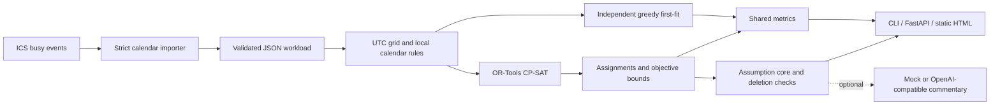

# schedule-solver

CP-SAT meeting scheduling with hard calendar constraints and checked conflict explanations.

- First-fit wastes capacity when flexible requests consume scarce windows. Optimize the whole workload instead.
- Enforce availability, local working hours, buffers, skills, roles, daily caps and optional hard load fairness.
- Explain tight constraints and return a deletion-minimal conflict certificate for every excluded request.

**100 people: 200 meetings versus greedy's 160 (+25%), in 1.056 seconds.**
The primary priority objective was proven optimal. Secondary objectives were not all
proven optimal; that run had more gap minutes than greedy. Full results below.

```sh
uv run schedule-solver demo --people 5 --seed 7 --time-limit 10 --output artifacts/demo
```

Captured output (timing varies):

```text
| People | Requests | Algorithm | Scheduled | Priority | Gap-min | Spread-min | Solve-s | Priority status |
|---:|---:|:---|---:|---:|---:|---:|---:|:---|
| 5 | 12 | greedy-first-fit | 8 | 18 | 120 | 60 | 0.001 | n/a |
| 5 | 12 | cp-sat | 10 | 20 | 30 | 60 | 0.056 | OPTIMAL |
```

No key or network access is needed after installing dependencies. The scheduling,
certificates, metrics, CLI, HTTP API and HTML calendar are non-AI code. An optional
OpenAI-compatible narrator can rephrase computed certificates; it cannot change them.

## Quickstart

Requires [uv](https://docs.astral.sh/uv/) and Python 3.12. From the repository root:

```sh
uv sync --frozen
uv run schedule-solver demo --people 5 --seed 7 --time-limit 10 --output artifacts/demo
# Open artifacts/demo/calendar.html in a browser.
```

The command writes `workload.json`, `result.json` (all explanations), and a static
`calendar.html`. Console explanations show the first pod to keep larger demos readable.
`uv run schedule-solver demo` also works as a one-command default demo.

[Actual mobile-width calendar capture](evidence/calendar.webp).

Python fits this project because OR-Tools exposes its native CP-SAT API directly,
`zoneinfo` handles local calendars, and Pydantic shares validation between the CLI
and FastAPI. There is no database or frontend build step.

## Architecture



## Input and interfaces

See [`examples/workload.json`](examples/workload.json) for a complete synthetic
input. IDs are strings. Timestamps need explicit offsets and minute precision.
Availability is **free time**; `busy` and imported ICS events subtract from it.
Working hours use IANA time zones and weekdays Monday=0 through Sunday=6.

A request specifies `duration_minutes`, `priority`, `earliest`, `latest`, and any
combination of `required_attendees`, `optional_attendees`, `skills`, and `roles`.
Skill/role dictionaries map names to minimum attendee counts. A person can satisfy
multiple requirements. Optional attendees are best-effort; they cannot reduce a
higher-ranked objective. The latest timestamp bounds the meeting's **end**.

```sh
uv run schedule-solver solve examples/workload.json --html artifacts/custom.html
uv run schedule-solver import-ics examples/workload.json p000 examples/busy.ics --output artifacts/merged.json
uv run schedule-solver solve artifacts/merged.json
uv run schedule-solver serve --port 8000
```

In another terminal:

```sh
curl -sS http://127.0.0.1:8000/health
uv run python -c 'import json; from schedule_solver.synthetic import generate; print(json.dumps({"workload": generate(5).model_dump(mode="json"), "time_limit": 2}))' | curl -sS --json @- http://127.0.0.1:8000/solve
```

| Endpoint | Contract |
|---|---|
| `GET /health` | Liveness only; no network provider dependency |
| `POST /solve` | `{"workload": ..., "time_limit": 10, "explanations": true}` → result JSON |
| `POST /compare` | Same input → `optimized` and `greedy` results |
| `POST /calendar` | Same input → escaped, script-free HTML calendar |

Invalid input returns HTTP 422. Diagnostic timeout returns 503, never a fabricated
conflict. CLI errors exit with status 2 and a short message. The service binds
loopback; it has no authentication, persistence, or production admission control.

## How optimization works

One start integer and one scheduled Boolean per request. Each eligible attendee
gets an optional buffered interval sharing that start. Allowed integer domains
encode calendar feasibility. `NoOverlap` enforces resource exclusivity; local-date
presence variables enforce daily caps.

Lexicographic passes:

1. Maximize scheduled priority.
2. Minimize non-required, non-optional staffing; do not add spectators to fake fairness.
3. Minimize internal person-day gap minutes.
4. Minimize workload-wide max-minus-min attendee meeting-minute load.
5. Maximize optional attendance, then minimize active person-days.

Each pass fixes its incumbent value. Search records `OPTIMAL`, `FEASIBLE` or
`UNKNOWN` and the objective bound. A subsequent optimal pass only proves optimality
**conditional on earlier fixed incumbent values**. A greedy warm start provides a
valid result even if CP-SAT never finds an incumbent. Such results are labelled
`cp-sat/greedy-warm-start`, not a proven CP optimum.

`--time-limit T` gives each pass a wall ceiling of `T/5` seconds and a deterministic
CP-SAT work budget of `T/100`. Construction and certificate extraction are outside
that ceiling. One worker, solver seed zero, and seeded workloads make search
repeatable on the pinned versions unless the wall safety ceiling fires. Wall times
are measurements, not expected output assertions.

## Explanations, precisely

Scheduled meetings report tight window boundaries, free-time/working-hour edges,
full daily caps, touching neighbor buffers, staffing requirements, and the chosen
team's static legal-start count. These are factual local constraints, **not proof
that this was the unique best slot**.

Unscheduled requests get an assumption-core certificate reduced by deletion checks.
For the returned subset, insertion is impossible; removing any one member admits
insertion with the remaining named constraints. Other members of the original
constraint universe are relaxed during those checks.

**The existing assignments stay fixed.** This is inclusion-minimal, not the
smallest-cardinality subset, and not proof that rearranging the calendar cannot
fit the request. If insertion is possible, the result explicitly says `insertable`
instead of calling it infeasible. Constraint groups include window, eligibility,
required attendees, skills/roles, free/busy time, working hours, frozen meetings,
daily caps and optional hard fairness.

Actual first exclusion from the demo:

```text
pod0-long0 [insertion_conflict]: Deletion-minimal conflict with the returned schedule held fixed; not minimum-cardinality and not a claim about rearranging meetings. Required attendees=['p000']; skills={}; roles={}. Eligibility restricts attendees to named people or holders of a requested skill/role. Frozen meeting pod0-second0: 2027-01-04T10:00:00+00:00 to 2027-01-04T11:00:00+00:00, attendees=['p000'], with each attendee's buffers. Conflict: eligibility:pod0-long0, meeting:pod0-second0.
```

The test suite independently removes every member from an example certificate and
checks that insertion becomes feasible. Full recorded output:
[`evidence/demo.txt`](evidence/demo.txt). Live HTTP smoke response:
[`evidence/api-smoke.json`](evidence/api-smoke.json).

## Benchmarks

Exact command used for the table:

```sh
uv run schedule-solver benchmark --seed 7 --time-limit 10 --output artifacts/benchmark
```

| People | Requests | Algorithm | Scheduled | Priority | Gap-min | Spread-min | Solve-s | Priority status |
|---:|---:|:---|---:|---:|---:|---:|---:|:---|
| 20 | 48 | greedy-first-fit | 32 | 64 | 480 | 60 | 0.007 | n/a |
| 20 | 48 | cp-sat | 40 | 72 | 300 | 60 | 0.379 | OPTIMAL |
| 50 | 120 | greedy-first-fit | 80 | 161 | 1200 | 60 | 0.039 | n/a |
| 50 | 120 | cp-sat | 100 | 181 | 1095 | 60 | 0.677 | OPTIMAL |
| 100 | 240 | greedy-first-fit | 160 | 351 | 2400 | 60 | 0.155 | n/a |
| 100 | 240 | cp-sat | 200 | 391 | 2580 | 90 | 1.056 | OPTIMAL |

Measured locally on macOS arm64, CPython 3.12.15, OR-Tools 9.15.6755 and uv 0.13.5.
`Solve-s` includes construction and optimization (and the optimizer's greedy warm
start); it excludes explanation extraction, file I/O and package startup. Gaps are
sum of last-end minus first-start minus occupied minutes per person/local day.
They include internal buffer time but exclude leading/trailing idle time.

The generator repeats synthetic contention/packing motifs with interchangeable
skill providers. A shared reviewer role introduces redundant cross-pod candidates;
staffing dominance pruning removes those only when mathematically safe. This is a
structured workload, not a broad random-calendar or production benchmark. Both
algorithms receive identical inputs. Greedy processes input order, takes the first
legal grid slot, and greedily fills skills without considering future requests.

The priority pass proved optimal at every scale. Several secondary passes stopped
with feasible incumbents. In the largest run, priority increased from 351 to 391,
but gaps increased from 2400 to 2580 and load spread increased from 60 to 90 minutes.
More meetings is not an automatic win on every secondary metric. Full pass values
and bounds: [`evidence/benchmark.json`](evidence/benchmark.json). The repeated run
matched all non-timing metrics; timings are hardware/load dependent.

## What's hard here

- **Local dates and combined buffers.** Compute in UTC, convert padded endpoints to
  local working hours, and count caps by attendee-local meeting date, including DST.
- **Honest infeasibility.** A sufficient unsat core is not minimal. Delete members
  and re-solve; distinguish fixed-schedule insertion from globally movable meetings.
- **Search size without changing the problem.** Replace slot truth tables with
  integer domains. Prune role-only staff when another requirement implies the role;
  disable that reduction under hard fairness because extra staff may be necessary.

## Tests and CI

```sh
uv run ruff check .
uv run ruff format --check .
uv run pytest --cov=schedule_solver --cov-report=term-missing --cov-fail-under=90 -q
```

Observed: **75 tests passed; 95.62% statement coverage.** Tests include a small
exhaustive priority oracle, an independent schedule-validity checker, DST folds,
local-day caps, buffers, fairness, minimal certificates, real CLI subprocesses,
FastAPI HTTP contracts, ICS parsing and the optional provider HTTP boundary.
One upstream Starlette TestClient/httpx deprecation warning remains; no test fails.
CI runs lint, format, coverage and an offline demo. No live LLM key is used in tests.

## Optional narrator

Default `--provider mock` is deterministic and offline. To explicitly send computed
certificate data to an OpenAI-compatible endpoint:

```sh
export SCHEDULE_LLM_BASE_URL="https://api.openai.com/v1"
# Set SCHEDULE_LLM_API_KEY in your shell; never commit it.
uv run schedule-solver demo --people 5 --provider openai --model gpt-4o-mini
```

Only explanations are sent, not calendar files. Explanations can still contain
attendee IDs and times: obtain permission before sending private calendar data.
Provider errors are surfaced. Hosted-provider execution was **not** tested with a
real key; the HTTP contract was tested with an injected transport.

## Design decisions and limitations

- Discrete UTC start grid, not continuous time. A coarse grid can miss a valid start.
  Durations and buffers are exact integral minutes, not rounded to grid size.
- All meetings and padded working hours stay within one attendee-local day.
  Split overnight shifts into explicit same-day schedules; overnight working-hours
  definitions are rejected. Meeting bodies must fit the horizon; buffers must fit
  availability and working hours.
- Fairness is raw meeting-minute spread across all people, not capacity-normalized
  utilization. Optional `max_load_difference_minutes` is a hard horizon-wide cap.
- Explicit ICS VEVENTs only. TZID and all-day events work. Floating timestamps,
  recurrence rules/dates/exclusions and recurrence overrides are rejected; expand
  them before import. Cancelled/transparent events do not block.
- Bounded synchronous local API: dense models and diagnosis can still be expensive.
  No hosted multi-user service, authentication, booking writes or calendar sync.
- Secondary objective optimality is not guaranteed at a finite search budget.
  Fixed-schedule certificates do not compute globally minimal rescheduling repairs.

[DESIGN.md](DESIGN.md) covers the model, proof boundaries and interview notes.

### Roadmap

Broader density/seed benchmark distributions; capacity-normalized fairness;
movable-meeting repair certificates; bounded recurrence expansion; worker-isolated
HTTP jobs with cancellation and admission control. None is a stub in this release.

MIT licensed. Built from scratch with synthetic inputs; no employer code or data.
